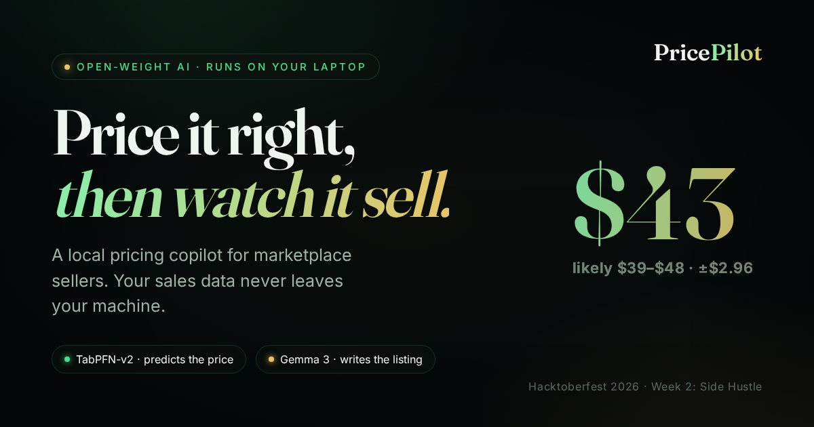
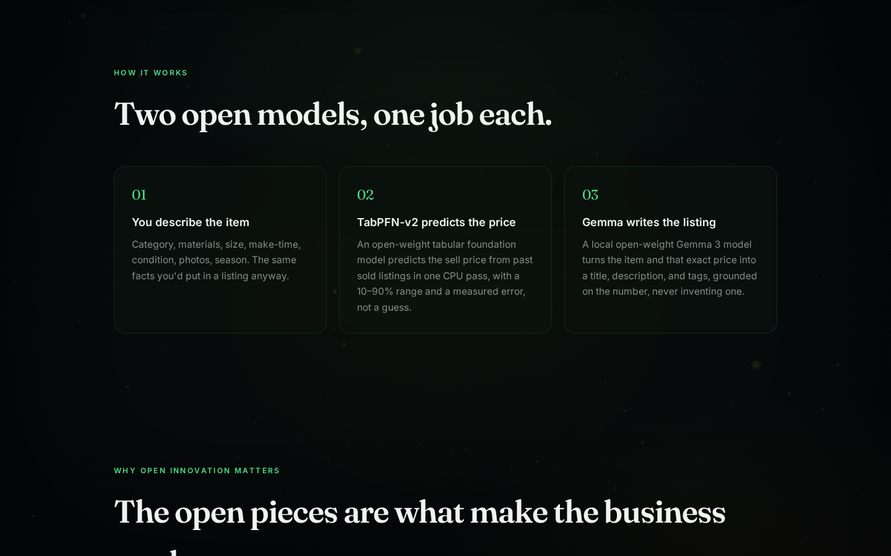

<div align="center">

# 💸 PricePilot

### Price It Right, Then Watch It Sell

[](https://simplynadaf.github.io/pricepilot)
[](https://youtu.be/CDzDQkIPkDA)
[](https://dev.to/sarvar_04)
[](https://github.com/PriorLabs/TabPFN)
[](LICENSE)

<br/>



<br/>

**Most Etsy and eBay sellers price by gut, and get it wrong.**<br/>
**Too high, it sits. Too low, you work for free.**<br/>
I built an open-weight model that prices it from data, on your own laptop.

<br/>

[Live Preview →](https://simplynadaf.github.io/pricepilot) &nbsp;|&nbsp; [Watch Demo →](https://youtu.be/CDzDQkIPkDA) &nbsp;|&nbsp; [Read Article →](https://dev.to/sarvar_04) &nbsp;|&nbsp; [How It Works →](#-how-it-works-two-open-models-one-job-each)

</div>

---

## 🎬 Demo

<div align="center">

[](https://youtu.be/CDzDQkIPkDA)

*Three real seller use cases (pendant, candle, leather wallet). Every input changes the price, because the model is predicting, not looking up a table. [Watch on YouTube →](https://youtu.be/CDzDQkIPkDA) · [Try the live demo →](https://simplynadaf.github.io/pricepilot/)*

</div>

---

## 🎯 One Form, Three Answers a Seller Can Act On

| Output | What You Get |
|--------|-------------|
| 🎯 **A price you can defend** | A predicted sell price **with an honest 10–90% range** (the risk, not a false-precise single number), plus a **measured error** so you know how much to trust it. |
| 🔼 **The levers that raise it** | A what-if loop that tells you *what to change and by how much*: "add photos **+$2**", "offer personalization **+$5**", "list in Q4 **+$8**", "premium materials **+$12**", ranked by dollar impact. |
| ✍️ **A listing, written for you** | A local Gemma model turns the item and that exact price into a **title, description, and 8 search tags**, grounded on the number, never inventing one. |

---

## ✨ Key Features

- 🧮 **Tabular foundation model** - TabPFN-v2 predicts the price in one CPU pass, no training
- 📊 **Honest range + measured error** - calibrated 10–90% band and a held-out MAE (~$2.90)
- 🔼 **Prediction-*agent* what-ifs** - re-queries the model to rank the levers that move the price
- ✍️ **Grounded listing writer** - Gemma 3 writes copy from the exact predicted number
- 🔒 **100% local** - your sales data never leaves your laptop; no account, no server
- 💸 **$0 per listing** - open weights mean no per-call API fee, ever
- 🔁 **Swappable + tunable** - drop in your own sales CSV, or point it at any Ollama model
- 🛟 **Never blocked** - a deterministic fallback writes a listing if the LLM is unreachable

---

## 📊 The Problem (Why Sellers Pay for This)

| Reality | Scale |
|---------|-------|
| The #1 thing handmade sellers get wrong | Pricing |
| What closed pricing SaaS costs | $10–30 / month, recurring |
| What those tools want in return | Your entire sales history, on their server |
| A seller's actual edge | Their margins + what sells, exactly what they'd be uploading |
| What PricePilot costs to run | $0, on the laptop they already own |

---

## 🛠️ Tech Stack

| Layer | Technology | Why |
|-------|-----------|-----|
| Price | [TabPFN-v2](https://github.com/PriorLabs/TabPFN) (open weights) | Tabular foundation model; predicts in one CPU pass, no per-dataset training |
| Listing | [Gemma 3](https://ai.google.dev/gemma) via [Ollama](https://ollama.com) | Open-weight LLM, runs locally, swappable |
| Fallback | Deterministic template (Python) | Correct listing with no model reachable |
| API | FastAPI + Uvicorn (localhost only) | Wires the two models, serves the UI |
| Front end | Vanilla HTML/CSS/JS, Three.js, GSAP | No build step, premium feel, deploys anywhere |
| Hosting | GitHub Pages (static preview) | Free; serves pre-computed real results |
| Runtime | Pure CPU | No GPU, no cloud, no account |

---

## 🚀 Quick Start

```bash
git clone https://github.com/simplynadaf/pricepilot.git
cd pricepilot

# CPU-only PyTorch (skip if you have a GPU build you prefer)
pip install torch --index-url https://download.pytorch.org/whl/cpu
pip install -r requirements.txt

# the local language model (open-weight) via Ollama
# install Ollama from https://ollama.com, then:
ollama pull gemma3:1b

python run.py        # → http://127.0.0.1:8088
```

Open the link, describe something you'd sell, and hit **Price my item**. The first run
downloads the TabPFN-v2 weights once and caches them; after that it runs fully offline.

> **Prove it is local:** turn off Wi-Fi after the models cache, then price another item.
> The price (TabPFN) still computes; if Gemma is reachable it writes the listing, otherwise
> the deterministic fallback does. Nothing calls out.

<details>
<summary>Run the price agent on its own (no server, no LLM)</summary>

```bash
python -m pricepilot.pricing   # prints a predicted price, range, MAE, and what-if levers
```
</details>

<details>
<summary>Rebuild the dataset / re-bake the static demo / validate the stack</summary>

```bash
python scripts/build_dataset.py   # regenerate data/sold_listings.csv
python scripts/bake_static.py     # regenerate web/static-data.json for the Pages preview
python scripts/validate.py        # end-to-end: API + TabPFN + Gemma + offline fallback
```
</details>

---

## 🧠 How It Works: two open models, one job each

<div align="center">

</div>

```
┌──────────────┐    ┌──────────────────┐    ┌─────────────────────┐
│  Item facts  │───▶│   TabPFN-v2      │───▶│  Price + 10–90%     │
│ (cat, size,  │    │  (open weights,  │    │  range + ranked     │
│  photos, …)  │    │   CPU, no train) │    │  what-if levers     │
└──────────────┘    └──────────────────┘    └──────────┬──────────┘
                                                        │  (price is passed in,
                                                        ▼   never invented)
                                               ┌─────────────────────┐
                                               │   Gemma 3 (Ollama)   │
                                               │   writes the listing │
                                               └──────────┬──────────┘
                                                        │ (if unreachable)
                                                        ▼
                                               ┌─────────────────────┐
                                               │  Deterministic rule  │
                                               │  writes the listing  │
                                               └─────────────────────┘
```

| Layer | Who decides | What happens |
|-------|-------------|--------------|
| **Price** | **TabPFN-v2** | Predicts the sell price from past sold listings in one CPU pass, with a calibrated 10–90% range. Used as a **prediction agent**: re-queried under single-feature changes to rank the levers that move the price. |
| **Listing** | **Gemma 3** (local) | Turns the item + predicted price into a title, description, and tags. Told the price; never invents one. |
| **Fallback** | Deterministic rule | Writes a correct listing from the same price if Ollama is unreachable. |

On the sample data, TabPFN predicts held-out sold prices with a **mean absolute error of
about $2.90** on items averaging ~$54, roughly 5% error, with zero training time.

---

## ⚖️ Why Open Innovation Matters

A closed, hosted model would have made this project *worse* in every way that matters for a side hustle:

| | |
|--|--|
| 🔒 **Your sales data stays yours** | Margins and best-sellers are a seller's edge. Nothing is uploaded to a vendor's cloud. A closed API would turn "what sells for me" into *its* dataset. |
| 💸 **$0 per listing** | Open weights mean no per-call fee. Reprice a whole shop weekly and the bill is nothing. |
| 🎯 **Tune it to your niche** | Drop in your own exported sales CSV and the model fits *your* corner of the market, where a general API is weak. |
| 🔁 **No vendor lock-in** | Point the writer at any open-weight model, or retrain the predictor. You own the stack, not a line on someone's pricing page. |

---

## 🏆 Built For

**[Hacktoberfest Open-Source AI Challenge, Week 2: Side Hustle](https://dev.to/challenges/hacktoberfest-week2-2026-10-12)**

| Category | How |
|----------|-----|
| **Best Use of TabPFN** | TabPFN-v2 is the core: it predicts the price, provides the calibrated range, and is wrapped in a what-if **prediction agent** that re-queries the model to explain which levers move the number. Accuracy is reported as a held-out MAE (~$2.90), measured, not asserted. |

---

## 📁 Project Structure

```
pricepilot/
├── pricepilot/              # the open-weight AI core
│   ├── api.py               # FastAPI: wires price + listing, serves the UI
│   ├── pricing.py           # TabPFN-v2 prediction agent (price, range, what-ifs, MAE)
│   └── listing.py           # Gemma 3 listing writer + offline fallback
├── web/                     # static front end (also the GitHub Pages preview)
│   ├── index.html
│   ├── static-data.json     # pre-computed real results for the hosted preview
│   └── assets/{app.js, scene.js}
├── data/sold_listings.csv   # 900 grounded sold listings (swap in your own)
├── scripts/
│   ├── build_dataset.py     # regenerate the dataset
│   ├── bake_static.py       # bake real results for the Pages preview
│   └── validate.py          # end-to-end validation
├── docs/                    # banner, screenshots, article draft
├── .github/workflows/deploy.yml   # auto-deploy the preview to GitHub Pages
├── run.py                   # one command to run everything
├── requirements.txt
├── LICENSE                  # MIT
└── README.md
```

---

## 🧾 The Honest Take

- **A predicted price is a forecast, not a promise.** The 10–90% range exists for a reason: demand, timing, and luck still move the real sale.
- **The sample dataset is grounded but synthetic.** 900 listings generated from realistic price drivers so the relationships are real and learnable, but it is a teaching dataset. **Swap in your own exported sales CSV** to make it yours; that is the whole point.
- **The language model only writes copy.** No price comes from Gemma; the number is TabPFN's.
- **CPU, so it is unhurried.** A full price-plus-listing takes ~20–30s on a laptop CPU. That is the cost of running everything locally instead of in someone's data center, worth it to keep your sales data on your own machine.

---

## 🙏 Credits & Prior Work

PricePilot reuses an architecture pattern I built for my Week 1 entry, **FrostWise**
(TabPFN-v2 for prediction, a local Gemma model for the language layer, FastAPI, a no-build
front end, and a deterministic offline fallback). **PricePilot is a new project**: new
repository, new domain, new dataset, new prediction target, and a new what-if prediction-agent
loop, built within the Week 2 window. Lineage noted per the challenge's "credit prior work" rule.

Model weights are licensed by their authors: TabPFN-v2 under the Prior Labs License, Gemma under the Gemma Terms of Use.

---

## 👤 Author

**Sarvar Nadaf** | Cloud Architect | Cloud, AI Infrastructure & DevOps

| Platform | Link |
|----------|------|
| 🌐 Portfolio | [sarvarnadaf.com](https://sarvarnadaf.com) |
| 💼 LinkedIn | [linkedin.com/in/sarvar04](https://www.linkedin.com/in/sarvar04/) |
| ✍️ Dev.to | [dev.to/sarvar_04](https://dev.to/sarvar_04) |
| 🐙 GitHub | [github.com/simplynadaf](https://github.com/simplynadaf) |

---

## 📄 License

MIT. See [LICENSE](LICENSE).

---

<div align="center">

**Because a side hustle shouldn't lose money to a bad guess.**

⭐ Star this repo if it helped you!

[](https://github.com/simplynadaf/pricepilot)

Built for the **Hacktoberfest Open-Source AI Challenge, Week 2: Side Hustle** · Made with 🤍 by [Sarvar](https://sarvarnadaf.com)

</div>
